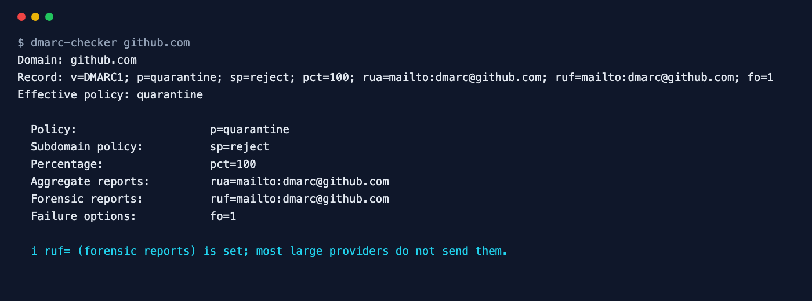
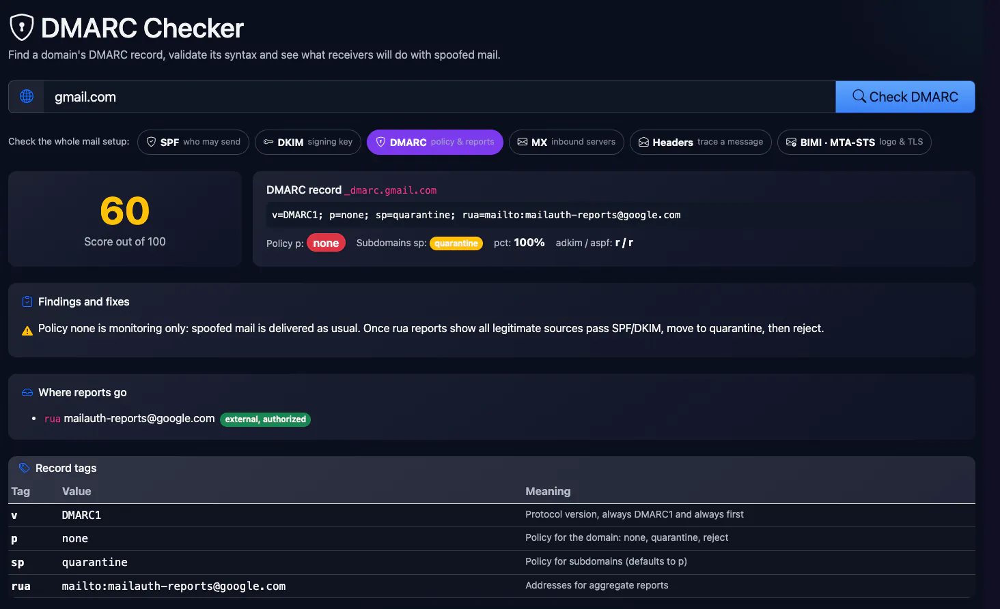
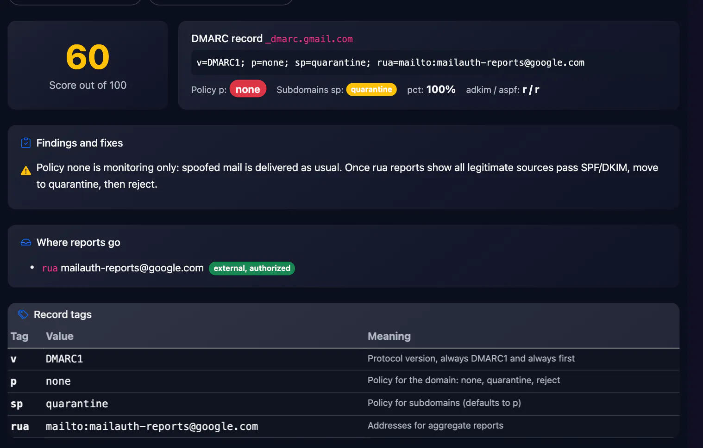
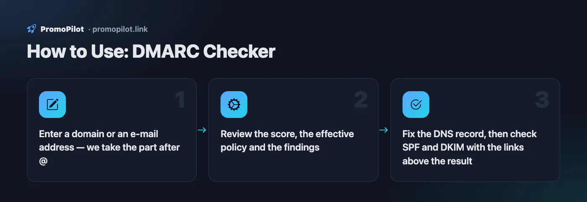

<div align="center">

# DMARC Checker

**Check your DMARC policy and reporting setup in one command.**

[](https://github.com/ksanyok/dmarc-checker/actions/workflows/ci.yml) [](LICENSE)   [](https://promopilot.link/en/tools/dmarc-checker.php?utm_source=github&utm_medium=repo&utm_campaign=tools&utm_content=dmarc-checker)

**[▶ Use the free online version — no install, no sign-up](https://promopilot.link/en/tools/dmarc-checker.php?utm_source=github&utm_medium=repo&utm_campaign=tools&utm_content=dmarc-checker)**

</div>

`dmarc-checker` finds a domain's DMARC record (falling back to the organizational domain like real receivers do), parses every tag, and tells you how strong the policy really is: `p=none` vs. enforcement, `pct` sampling, subdomain policy, alignment modes and whether your aggregate-report addresses on other domains are authorized to receive them.



## What it checks

- A DMARC record exists at `_dmarc.<domain>` — and only one (two records means none is used)
- Subdomains without their own record inherit the organizational domain policy (`sp=` if set), like real receivers do
- Syntax of every tag: `v`, `p`, `sp`, `np`, `pct`, `adkim`, `aspf`, `fo`, `rf`, `ri`, `rua`, `ruf`
- Policy strength: `p=none` (monitoring only), partial `pct`, `sp=none` under an enforced main domain
- Reporting: missing `rua=`, malformed `mailto:` URIs, size limits like `!10m`
- External report destinations are authorized via `<domain>._report._dmarc.<destination>` (RFC 7489 §7.1)
- Strict alignment and records too long for a single TXT string

## Why it matters

DMARC is the only part of email authentication that tells receivers what to do when a message claiming to be from your domain fails SPF and DKIM. Without it — or with `p=none` forever — anyone can send mail that looks like it came from you, and Gmail and Yahoo now require a DMARC record from bulk senders. The record is a short string, but a typo, a second record from a new provider or a report address on an unauthorized domain silently breaks it. You find out when invoices from your domain start phishing your customers.

## Quick start

```bash
# run straight from GitHub, nothing to install
npx github:ksanyok/dmarc-checker example.com

# or install the CLI globally
npm install -g github:ksanyok/dmarc-checker
dmarc-checker example.com
```

Lint a record before publishing it (no DNS needed):

```bash
dmarc-checker --record "v=DMARC1; p=quarantine; pct=25; rua=mailto:dmarc@example.com"
```

Check a subdomain (falls back to the parent policy):

```bash
dmarc-checker mail.example.com
```

JSON for monitoring scripts:

```bash
dmarc-checker example.com --json | jq '.policy, .issues'
```

## Example output

```text
$ dmarc-checker github.com
Domain: github.com
Record: v=DMARC1; p=quarantine; sp=reject; pct=100; rua=mailto:dmarc@github.com; ruf=mailto:dmarc@github.com; fo=1
Effective policy: quarantine

  Policy:                    p=quarantine
  Subdomain policy:          sp=reject
  Percentage:                pct=100
  Aggregate reports:         rua=mailto:dmarc@github.com
  Forensic reports:          ruf=mailto:dmarc@github.com
  Failure options:           fo=1

  i ruf= (forensic reports) is set; most large providers do not send them.
```

## CLI

```text
Usage: dmarc-checker <domain> [options]
       dmarc-checker --record "v=DMARC1; p=reject; rua=mailto:dmarc@example.com"

Looks up _dmarc.<domain> (falling back to the organizational domain), validates
every tag and reports weak policies and unauthorized report destinations.

Options:
  --record <dmarc>  Lint a record string offline instead of querying DNS
  --json            Print the full report as JSON
  --no-report-auth  Skip the external report destination check
  --strict          Exit with code 1 on warnings too
  -h, --help        Show this help

Online version (no install): https://promopilot.link/en/tools/dmarc-checker.php?utm_source=github&utm_medium=cli&utm_campaign=tools&utm_content=dmarc-checker
```

## Use as a library

```js
import { checkDmarc, parseDmarc, lintDmarc } from '@promopilot/dmarc-checker';

const report = await checkDmarc('example.com');
console.log(report.record, '→ effective policy:', report.policy);
for (const issue of report.issues) console.log(issue.level, issue.code, issue.message);

// Offline helpers
parseDmarc('v=DMARC1; p=reject; rua=mailto:d@example.com'); // { tags: { v, p, rua }, errors: [] }
lintDmarc('v=DMARC1; p=none');                            // [{ code: 'policy-none', ... }, { code: 'no-rua', ... }]

// Custom DNS (DoH, tests, a specific resolver):
await checkDmarc('example.com', { resolveTxt: async (name) => myTxtLookup(name) });
```

`checkDmarc(domain, { resolveTxt, checkReportAuth, orgDomain })` returns `{ domain, source, record, tags, policy, issues[], ok }`. `source` is the domain the record was actually found on; `policy` is the effective one for the queried name. Issue codes are stable (`no-dmarc`, `multiple-dmarc`, `policy-none`, `partial-pct`, `no-rua`, `report-not-authorized`, `syntax`, …).

## Use in CI (GitHub Actions)

Fail a scheduled job the day someone weakens or breaks your DMARC policy:

```yaml
on:
  schedule: [{ cron: '0 6 * * *' }]
jobs:
  check:
    runs-on: ubuntu-latest
    steps:
      - uses: ksanyok/dmarc-checker@v1
        with:
          args: example.com --strict
```

## How it works

The checker queries the TXT records of `_dmarc.<domain>` with Node's built-in resolver and keeps the ones starting with `v=DMARC1`. If there are none and the name is a subdomain, it repeats the lookup on the organizational domain (last two labels, or three for suffixes like `co.uk`) — the same fallback receivers use. Tags are split on `;`, validated against RFC 7489, and linted for policy weaknesses. For every `rua`/`ruf` address on a different domain it looks up the authorization record that the destination must publish, otherwise many receivers silently drop your reports.

## CLI vs. online version

| | This package | [Online tool](https://promopilot.link/en/tools/dmarc-checker.php?utm_source=github&utm_medium=repo&utm_campaign=tools&utm_content=dmarc-checker) |
|---|---|---|
| Runs on | Your machine, CI, cron | Any browser |
| Offline linting | Yes, `--record` | — |
| Output | Text, JSON, exit codes | Visual report with explanations |
| Extras | Custom resolver, library API | SPF, DKIM, BIMI and MX checks on one site |
| Price | Free, MIT | Free, no sign-up |







## FAQ

<details>
<summary><b>Is p=none bad?</b></summary>

It is the right first step — you get reports without risking legitimate mail. It is bad as a permanent state: `p=none` does not stop a single spoofed message. Read a few weeks of aggregate reports, fix the senders that fail, then move to `p=quarantine` and later `p=reject`.
</details>

<details>
<summary><b>What does pct do?</b></summary>

`pct` applies the policy to only that percentage of failing messages; the rest are treated one step softer. It is useful for a gradual rollout (`pct=10` → `50` → `100`) but should end at 100.
</details>

<details>
<summary><b>Why are my reports not arriving?</b></summary>

Check that `rua=` uses `mailto:` and, if the address is on another domain (a DMARC reporting service, for example), that the destination publishes `yourdomain.com._report._dmarc.destination.com` with `v=DMARC1`. This tool checks that for you.
</details>

<details>
<summary><b>Do subdomains need their own record?</b></summary>

No. Without one, receivers use the organizational domain record and its `sp=` tag (or `p=` if `sp` is absent). Add a separate record only if a subdomain needs a different policy or reports.
</details>

<details>
<summary><b>What is the difference between relaxed and strict alignment?</b></summary>

With relaxed alignment (`r`, the default) `mail.example.com` aligns with `example.com`. With strict (`s`) the domains must match exactly. Strict is rarely needed and breaks mail sent from subdomains.
</details>

<details>
<summary><b>Is there a version without installing anything?</b></summary>

Yes — the [online DMARC Checker](https://promopilot.link/en/tools/dmarc-checker.php?utm_source=github&utm_medium=repo&utm_campaign=tools&utm_content=dmarc-checker) runs the same checks in the browser and explains each result.
</details>

## Related free tools

- [SPF Checker](https://promopilot.link/en/tools/spf-checker.php?utm_source=github&utm_medium=repo&utm_campaign=tools&utm_content=spf-checker) — validate SPF and the 10-lookup limit
- [DKIM Checker](https://promopilot.link/en/tools/dkim-checker.php?utm_source=github&utm_medium=repo&utm_campaign=tools&utm_content=dkim-checker) — find selectors and validate DKIM keys
- [BIMI Checker](https://promopilot.link/en/tools/bimi-checker.php?utm_source=github&utm_medium=repo&utm_campaign=tools&utm_content=bimi-checker) — brand logo record, SVG Tiny PS and VMC
- [MX Lookup](https://promopilot.link/en/tools/mx-lookup.php?utm_source=github&utm_medium=repo&utm_campaign=tools&utm_content=mx-lookup) — mail servers, priorities and provider detection
- [Email Header Analyzer](https://promopilot.link/en/tools/email-header-analyzer.php?utm_source=github&utm_medium=repo&utm_campaign=tools&utm_content=email-header-analyzer) — trace hops and read SPF/DKIM/DMARC results
- [All 120+ free SEO, email and web tools](https://promopilot.link/en/tools/?utm_source=github&utm_medium=repo&utm_campaign=tools&utm_content=dmarc-checker)

## Contributing

Bug reports and pull requests are welcome — see [CONTRIBUTING.md](CONTRIBUTING.md). Security issues: [SECURITY.md](SECURITY.md).
More docs live in the [wiki](https://github.com/ksanyok/dmarc-checker/wiki) (sources in [docs/wiki](docs/wiki)).

## License

[MIT](LICENSE) © 2026 Alexandr Krikun

---

<sub>Built and maintained by the team behind [PromoPilot](https://promopilot.link/?utm_source=github&utm_medium=repo&utm_campaign=tools&utm_content=dmarc-checker) — link building, SEO monitoring and 120+ free tools for site owners. Also on [YouTube](https://www.youtube.com/channel/UCPB8m7BgaexcZh0Vr49ViYA).</sub>
